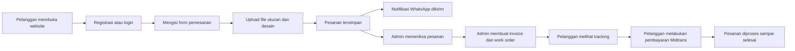

<div align="center">
  

  <h1>Emoka Konveksi</h1>

  <p>
    Website pemesanan konveksi berbasis Laravel untuk membantu pelanggan membuat pesanan custom,
    mengunggah desain, memantau status produksi, melakukan pembayaran, dan menerima notifikasi WhatsApp.
  </p>

  <p>
    
    
    
    
  </p>
</div>

---

## Gambaran Website

**Emoka Konveksi** adalah aplikasi web untuk layanan konveksi custom. Website ini menyediakan halaman landing untuk memperkenalkan layanan, produk, kontak, dan portofolio, lalu dilengkapi sistem pemesanan online yang menghubungkan pelanggan dengan admin produksi.

Pelanggan dapat membuat pesanan pakaian, mengisi detail ukuran, mengunggah file data ukuran, menambahkan file desain, melihat estimasi harga, memantau status pesanan, mencetak invoice, membatalkan pesanan tertentu, dan melakukan pembayaran melalui Midtrans Snap.

Di sisi admin, aplikasi menyediakan dashboard ringkas untuk melihat pesanan, mengatur status produksi, membuat invoice, mengelola produk, mencetak work order, serta mengirim pembaruan status melalui WhatsApp.

---

## Fitur Utama

### Untuk Pelanggan

| Fitur | Deskripsi |
| --- | --- |
| Landing page | Menampilkan profil Emoka, layanan, produk, portofolio, statistik, dan kontak. |
| Registrasi dan login | Pelanggan dapat membuat akun dan masuk ke sistem. |
| Form pemesanan | Pelanggan mengisi data pemesan, jenis pakaian, alamat, deskripsi pesanan, dan jumlah. |
| Detail ukuran | Pesanan dapat memakai total jumlah langsung atau detail ukuran per item. |
| Upload file ukuran | Mendukung file `pdf`, `xlsx`, `xls`, dan `csv`. |
| Upload desain | Pelanggan dapat menambahkan beberapa desain seperti logo, tampak depan, tampak belakang, atau kebutuhan lain. |
| Estimasi harga | Harga sementara dihitung dari jenis pakaian, ukuran, dan jumlah. |
| Tracking pesanan | Pelanggan dapat melihat status pesanan yang sedang berjalan. |
| Pembayaran Midtrans | Pesanan dengan status tertentu dapat dibayar melalui Midtrans Snap. |
| Invoice pelanggan | Invoice dapat dibuka dan dicetak dari halaman pesanan. |
| Pembatalan pesanan | Pelanggan dapat membatalkan pesanan yang masih memenuhi kondisi pembatalan. |

### Untuk Admin

| Fitur | Deskripsi |
| --- | --- |
| Dashboard admin | Menampilkan jumlah pengguna, pesanan menunggu, produksi, selesai, dan pesan masuk. |
| Data pemesanan | Admin dapat melihat daftar pesanan pelanggan. |
| Update status pesanan | Status pesanan dapat diperbarui sesuai proses produksi. |
| Notifikasi WhatsApp | Pelanggan menerima pemberitahuan ketika pesanan dibuat atau status berubah. |
| Pembuatan invoice | Admin dapat mengatur harga satuan dan total tiap detail pesanan. |
| Manajemen produk | Admin dapat menambah dan menghapus produk beserta gambar utama dan gambar crop. |
| Work order | Admin dapat mengisi detail produksi seperti tanggal, jenis kain, warna kain, dan furing. |
| Cetak work order | Work order dapat dicetak, termasuk membaca data dari file Excel ukuran bila tersedia. |

---

## Alur Sistem



---

## Teknologi

| Bagian | Teknologi |
| --- | --- |
| Backend | Laravel 10, PHP 8.1+ |
| Frontend | Blade, Bootstrap, jQuery, SweetAlert2 |
| Build tool | Vite |
| Database | MySQL atau database lain yang didukung Laravel |
| Payment gateway | Midtrans Snap |
| WhatsApp gateway | Wablas API |
| Spreadsheet reader | PhpSpreadsheet |
| UI assets | Bootstrap Icons, AOS, GLightbox, Swiper, Font Awesome |

---

## Struktur Direktori Penting

```text
app/
  Http/Controllers/
    AdminController.php
    AuthController.php
    LandingController.php
    PemesananController.php
    ProfileController.php
  Models/
    Pemesanan.php
    DetailPesanan.php
    Produk.php
    WorkOrder.php

resources/views/
  landingPage.blade.php
  form-pemesanan.blade.php
  trackingPesanan.blade.php
  profile.blade.php
  admin/
    dashboard.blade.php
    data-pemesanan.blade.php
    invoice.blade.php
    produk.blade.php
    cetak_work_order.blade.php

public/
  img/
  desain/
  produkEmoka/
  vendor/

routes/
  web.php
```

---

## Instalasi Lokal

Pastikan sudah tersedia:

- PHP 8.1 atau lebih baru
- Composer
- Node.js dan npm
- MySQL
- Web server lokal seperti Laragon, XAMPP, atau Laravel Artisan Serve

Langkah menjalankan proyek:

```bash
composer install
npm install
cp .env.example .env
php artisan key:generate
php artisan migrate
npm run build
php artisan serve
```

Jika menggunakan Laragon, arahkan document root ke folder `public` atau akses proyek melalui virtual host yang sudah dibuat Laragon.

---

## Konfigurasi Environment

Atur koneksi database di `.env`:

```env
DB_CONNECTION=mysql
DB_HOST=127.0.0.1
DB_PORT=3306
DB_DATABASE=emoka_konveksi
DB_USERNAME=root
DB_PASSWORD=
```

Atur konfigurasi Midtrans di `.env`:

```env
MIDTRANS_SERVER_KEY=your-server-key
MIDTRANS_CLIENT_KEY=your-client-key
MIDTRANS_IS_PRODUCTION=false
```

Konfigurasi WhatsApp gateway digunakan untuk mengirim pesan otomatis saat pesanan dibuat atau status pesanan diperbarui.

---

## Akun Admin Default

Aplikasi memiliki login admin sederhana melalui controller:

```text
Email    : admin@emoka.com
Password : admin123
```

Setelah login sebagai admin, sistem akan mengarahkan ke dashboard admin.

---

## Status Pesanan

Status pesanan yang digunakan dalam sistem:

| Status | Keterangan |
| --- | --- |
| Menunggu | Pesanan baru masuk dan menunggu pengecekan admin. |
| Belum Bayar | Invoice sudah dibuat dan pelanggan perlu melakukan pembayaran. |
| Sudah Bayar | Pembayaran telah dilakukan. |
| Produksi | Pesanan sedang diproduksi. |
| Pengiriman | Pesanan sedang dikirim. |
| Selesai | Pesanan telah selesai. |
| Dibatalkan | Pesanan dibatalkan oleh pelanggan atau admin. |

---

## Highlight Pengalaman Pengguna

- Form pemesanan dibuat bertahap agar pelanggan mudah mengisi kebutuhan produksi.
- Upload desain mendukung beberapa file sehingga pelanggan bisa menjelaskan kebutuhan visual lebih detail.
- Tracking pesanan menjaga pelanggan tetap tahu posisi pesanannya.
- Pembayaran Midtrans membuat transaksi lebih praktis.
- Notifikasi WhatsApp membantu komunikasi antara Emoka dan pelanggan tetap cepat.
- Admin memiliki work order untuk menjembatani data pesanan dengan kebutuhan produksi.

---

## Perintah Pengembangan

```bash
# Menjalankan Vite saat development
npm run dev

# Build asset production
npm run build

# Menjalankan server Laravel
php artisan serve

# Menjalankan migrasi database
php artisan migrate
```

---

## Catatan Keamanan

- Jangan commit file `.env` ke repository.
- Simpan API key Midtrans dan WhatsApp gateway hanya di environment lokal/server.
- Ganti akun admin default sebelum aplikasi dipakai di production.
- Pastikan folder upload seperti `public/desain` dan `public/produkEmoka` memiliki permission yang sesuai.

---

<div align="center">
  <strong>Emoka Konveksi</strong>
  <br>
  Sistem pemesanan konveksi custom yang rapi, praktis, dan siap membantu proses produksi dari form sampai invoice.
</div>
